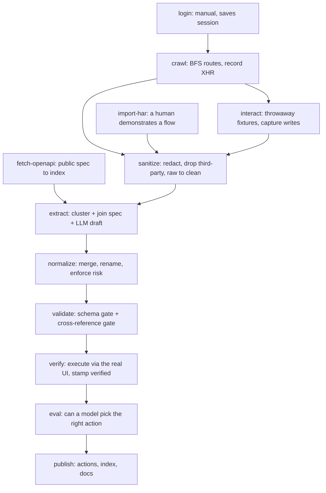

# brevo-agent-catalog

**A catalog of Brevo's business actions — everything a user can do by clicking
around the product — in a form an AI agent can act on.**

Brevo's public API does not describe its product. This repository reverse
engineers what the product actually does, from the product's own traffic, and
ships it as a typed, validated, agent-consumable catalog with an eval that
scores whether a model can use it.

---

## The result

| | |
|:--|:--|
| **Actions catalogued** | **197** across 62 modules |
| **Write endpoints in the capture / covered** | **38 / 38** |
| **Selection eval** | **17 of 19** scoreable tasks |
| **Executed against the live account** | **3** `verified`, 194 `observed` |
| **Requests observed / committed as evidence** | 38 132 / 2 147 |
| **Overlap with Brevo's published OpenAPI spec** | **0 of 197** |
| **Tests / typecheck / leak gate** | 470 passing · strict · clean |

The last row is the finding the project rests on. Brevo publishes an OpenAPI
3.0.1 spec with **292 operations across 208 paths**, and not one of the 197
endpoints this catalog documents appears in it. An earlier, smaller catalog
managed 2 of 126; tripling the capture and adding every write flow did not add a
single match. **The overlap is not small because the coverage is thin — these
are different APIs.** Reading the docs is not a substitute for clicking around
the app, which is the whole argument for building it this way.

### The headline caveat, stated first

**194 of 197 entries are `observed`, not `verified`.** That means a model drafted
them from captured traffic — the endpoint, method and body shape are factual,
but nothing executed them. Three entries were executed end to end against a real
account and matched the request that actually happened:

```
contacts.create_contact   POST   /contact/backend/contacts/add-contact  → 200  {"contact_id":8}
contacts.delete_contact   DELETE /contact/backend/contacts/8            → 200
lists.create_list         POST   /lists/create                          → 201  {"id":11}
```

The create-then-delete pair is the useful part: the same contact id appears on
both sides, so the lifecycle is proved rather than inferred. Everything else is
a well-evidenced hypothesis, and [docs/gaps.md](docs/gaps.md) says so at length.

---

## Start here

Pick the path that matches what you want to judge.

| If you have | Read this | Why |
|:--|:--|:--|
| **2 minutes** | this page, then [`actions/index.json`](actions/index.json) | The result, then the artifact itself |
| **10 minutes, and you want to judge the engineering** | [docs/decisions.md](docs/decisions.md) | 13 decisions, each with its rejected alternative and the cost accepted |
| **10 minutes, and you want to judge the AI usage** | [docs/ai-usage.md](docs/ai-usage.md) and *[Built with AI](#built-with-ai-and-what-that-actually-looked-like)* below | What the model was spent on, and every place it was wrong |
| **You want to know what is broken** | [docs/gaps.md](docs/gaps.md) | Every gap, measured, with what more time would buy |
| **You want proof it works** | [docs/eval.md](docs/eval.md) | Seven eval runs, including the ones that failed |
| **You want the full inventory** | [docs/modules.md](docs/modules.md) | Generated: every module, action and uncovered route |

Every number in this repository is measured rather than estimated, and the
uncomfortable ones are stated before the flattering ones. Where a claim was
disproved by a run, the claim was changed — the git history is the audit trail.

---

## How to read the catalog

| Path | What it is |
|:--|:--|
| [`actions/index.json`](actions/index.json) | **Load this first.** Every action's id, module, name, description, status and risk flags, in one small file |
| `actions/<id>.json` | One action in full: typed inputs, outputs, preconditions, side effects, UI path, internal endpoint, public-API mapping, verification evidence |
| [`schema/action.schema.json`](schema/action.schema.json) | The contract, JSON Schema draft 2020-12. Generated from `src/types.ts`; a test fails if the two drift |
| `captures/clean/` | The sanitized traffic every entry is derived from. This is what `verification.evidence` points at |

Ids are `module.verb_object` in snake_case — `contacts.create_contact`,
`campaigns.send_now`, `segments.count_paginated`.

### What the status means

The catalog does not claim uniform confidence, and the distinction is enforced
in code rather than described in prose.

| Status | Earned when | Count |
|:--|:--|:--|
| `verified` | The harness executed the action against a real account, and the request that happened matches what the entry claims | **3** |
| `observed` | The endpoint was captured in real traffic — method, path and body shape are factual — but it was never executed, or only partly | **194** |
| `inferred` | No captured traffic. Derived from UI affordances, the spec, or model judgment | **0** |

Two rules hold, both in `src/verify/harness.ts`:

- **Partial execution does not earn `verified`.** A request that ran and returned
  4xx stays `observed`, with the reason recorded. So does one that matched the
  path but came from a non-Brevo host — otherwise a third-party widget answering
  the same path could stamp an action verified.
- **A re-run never demotes.** A recipe that breaks because Brevo moved its
  markup has learned nothing about the original execution, and overwriting that
  evidence destroys it for no gain.

### `destructive` is a fact about Brevo, not about the HTTP method

An agent uses `destructive` to decide whether to stop and ask a human, so a
wrong value here is the most expensive error this catalog could carry. It means
**irreversible, or visible outside the account** — which is not the same as "not
a read":

- `contacts.create_contact` mutates and is **not** destructive: reversible, and
  it touches only data the account owns.
- `campaigns.send_now` creates nothing and **is** destructive: it mails real
  people, and there is no undo.

Deriving this from the method was tried and failed, because **Brevo reads through
POST** (`segment/count`, `segment/query`, `paginated_count`). That rule shipped
`get_count` and `fetch_email_logs` as `destructive: true` — an agent obeying the
flag refuses four harmless reads, and an agent that learns to ignore it on reads
will ignore it on `delete` too. 7 of 197 entries are destructive. The rule, its
failures in both directions, and the two verbs it deliberately refuses to
classify are in [`src/catalog/risk.ts`](src/catalog/risk.ts) and decision #12.

---

## How it was built



**The principle is to spend the model only on what cannot be derived.** Every
mechanical field — `internal_endpoint`, `public_api`, `verification` — is filled
from evidence in code, because asking a model for facts you already hold is the
main source of fabricated documentation. The model is asked for semantics only:
the agent-facing description, preconditions, side effects.

**The stage that mattered most was not the one designed to matter.** Driving
writes by selector reached **two of six** target routes — a segment builder, a
campaign split-button, the drag-and-drop template editor and a wrong senders URL
all defeated it. Each wizard is hours of selector work that breaks on the next
release; a person performs the same flow in thirty seconds. So the coverage came
from four hand-driven DevTools recordings imported through `pnpm import:har`,
which took the write endpoints from 4 to 38. `parseHar` had been written and
tested in the first week with no caller.

---

## Built with AI, and what that actually looked like

This was built with Claude Code, and the honest version of that story is more
useful than a tooling list. Two models sit behind one interface
([`src/providers/types.ts`](src/providers/types.ts)) and are split by job: **Groq**
runs the high-volume breadth pass across every discovered route, **headless
Claude Code** handles judgment and verification. The Groq key is optional and a
reviewer can substitute their own provider.

What is worth your attention is where the model was wrong, because every one of
these was caught by a check rather than by reading the output:

| What went wrong | How it was caught | The fix |
|:--|:--|:--|
| **6 fabricated actions.** I had suggested fetching `/mark_NN_<flow>` URLs as session markers; the extractor treated them as real endpoints and the model wrote confident entries with invented outputs | Reading the catalog for a different reason | Deleted, plus `OPERATOR_MARKER` in `isNoise` with a test that a real `/marketing/*` route still survives |
| **41 invented action ids, cited 42 times** — "Use `contacts.import_contacts` instead", which does not exist | A checker written specifically to look | The prompt now asks for the neighbour *by what it does*; `pnpm validate` gates the count at zero |
| **Risk flags wrong in both directions** — reads flagged destructive, and a bulk dispatcher right only by luck | Measuring the rule against all 197 ids | Read-verb-first beats the dangerous-token scan; `bulk` escalates because no name can classify a dispatcher |
| **Two PII leak classes the gate called clean** — phone numbers had no rule, and `%40`-encoded emails defeated a literal-`@` regex | Grepping the committed captures by hand | Keyed phone rule, encoded-email shapes, and a redact-then-scan round-trip test |
| **An opaque failure message cost two extraction runs** — `withDeadline` swallowed the provider's error, so a 429, a dead key and a bad response read identically | Instrumenting the swallowed error | The real cause turned out to be Groq's **tokens-per-day** cap, not per-minute — so pacing could never have fixed it |

The eval is the part designed to resist me. It scores whether a model can pick
the right action from a natural-language task, and one of its two remaining
misses is a limit of the harness rather than a defect in the catalog — a
one-shot selection eval cannot fairly score a two-step task.
[docs/eval.md](docs/eval.md) has all seven runs, including the run where my own
expected answer was wrong and the model's was right.

---

## Running it

Requires Node 20+ and pnpm. `pnpm install`, then:

| Command | Stage | Needs |
|:--|:--|:--|
| `pnpm build:schema` | Regenerate `schema/action.schema.json` from `src/types.ts` | nothing |
| `pnpm fetch:openapi` | Download and index Brevo's public spec | nothing |
| `pnpm brevo:login` | Save an authenticated session to `.auth/` | **a manual login by hand** |
| `pnpm crawl` | BFS the app, recording XHR | a saved session |
| `pnpm interact` | Write passes with throwaway fixtures | a saved session |
| `pnpm explore` | Selector reconnaissance: what a create control actually opens | a saved session |
| `pnpm import:har` | Ingest a DevTools HAR export | a `.har` file |
| `pnpm sanitize` | `captures/raw` → `captures/clean`, redacted | captures |
| `pnpm extract` | Draft catalog entries | clean captures + a provider |
| `pnpm normalize` | Merge duplicates, enforce the risk rule | drafted actions |
| `pnpm validate` | Schema gate **and** cross-reference gate | drafted actions |
| `pnpm build:index` | Write `actions/index.json` | valid actions |
| `pnpm verify` | Execute chosen actions, stamp `verified` | a saved session |
| `pnpm eval` | Score whether a model picks the right action | a catalog index |
| `pnpm fix:crossrefs` | Rewrite prose citing ids that do not exist | a catalog + a provider |
| `pnpm build:docs` | Regenerate `docs/modules.md` | a catalog index |
| `pnpm scan` | **Leak gate.** Run before any push | nothing |
| `pnpm test` / `pnpm typecheck` | 470 tests, strict TypeScript | nothing |

**Reproducibility.** `captures/clean/` **is committed**, so everything from
`extract` onward runs offline for anyone, against the same evidence this catalog
was built from. The capture stages (`login`, `crawl`, `interact`, `import:har`)
need a Brevo account of your own.

**Credentials.** None are committed. `pnpm extract --provider groq` wants
`GROQ_API_KEY` in `.env` (see [`.env.example`](.env.example)); `--provider claude`
shells out to an already-authenticated `claude` CLI and needs no key. There is
**no Brevo API key anywhere** — verification drives the real UI instead, which is
the only way to reach the UI-only surfaces where this catalog is worth the most.

---

## Safety

This repository is public, so that is treated as a hard constraint rather than a
disclaimer.

- `.env`, `.auth/`, `captures/raw/` and `test-results/` are gitignored. The raw
  logs hold session cookies and a signed-in email; a Playwright trace holds
  screenshots of a logged-in account. None of it is committed, and that was
  verified against the git history before the first push.
- **Sanitization is by shape, wherever it occurs** — a key in a query string, a
  token nested deep in a body, a cookie header. Not just known field names. One
  exception is deliberate: a phone number cannot be found by shape, because it
  is indistinguishable from an epoch timestamp, so that rule is keyed on the
  JSON field name instead.
- Identifiers become structure-preserving placeholders (`{{ACCOUNT_ID}}`,
  `{{LIST_ID}}`, `{{EMAIL}}`), never bare removal, so `body_example` stays usable
  by an agent.
- `pnpm scan` is an **independent** second opinion: it re-derives the patterns
  rather than asking the redactor what it would have replaced, because a gate
  implemented by calling the thing it checks cannot fail. It has caught the
  redactor twice.
- `pnpm sanitize` commits only Brevo's own traffic. Of 35 035 records in the HAR
  sessions, 1 324 were Brevo and 33 711 were analytics and trackers — 2.8 MB
  against 67.8 MB — and third-party requests are the worst PII surface in a
  capture and the least useful.
- The crawl is capped at 1 request/second and never follows a log-out link.
- **One recipe deletes account data**, with the account owner's explicit
  approval, because `destructive: true` is the flag an agent obeys and leaving
  the destructive entries unverified means the part of the catalog that matters
  most is the part nothing has proved. The caution lives in a guard rather than
  in abstention: it reads the address off the page it is about to act on and
  refuses anything that is not one of its own `catalog-test-` fixtures.

---

## Documents

| Document | What it covers |
|:--|:--|
| [docs/approach.md](docs/approach.md) | How the problem was framed, what was prioritized, and what the runs disproved |
| [docs/decisions.md](docs/decisions.md) | 13 decisions, each with its rejected alternative and the cost accepted |
| [docs/ai-usage.md](docs/ai-usage.md) | Tools, models, workflow, and what had to be fixed by hand |
| [docs/gaps.md](docs/gaps.md) | Known gaps and limitations, measured, and what more time would buy |
| [docs/eval.md](docs/eval.md) | Selection-eval results across seven runs and what each failure taught |
| [docs/modules.md](docs/modules.md) | Generated inventory of modules, actions and uncovered routes |
| [docs/superpowers/specs/](docs/superpowers/specs/) | The design document, written before any code |
| [docs/superpowers/plans/](docs/superpowers/plans/) | The implementation plan it produced |
