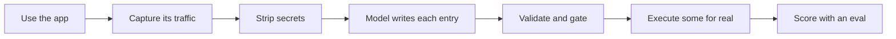

<div align="center">

# brevo-agent-catalog

**What can a user do in this app? Ask the app, not its docs.**


</div>

> **If you are an agent:** read [AGENTS.md](AGENTS.md), or run
> `pnpm catalog help`. Answer product questions with `pnpm catalog`, not by
> reading `actions/*.json`. Nothing here performs an action.

## Ask it

```bash
pnpm install
pnpm catalog
```

```
A user can do 170 things in this app, across 8 areas.
31 of them change something; the other 139 only look.

Contacts and audiences  —  12 to change, 52 to look at, 3 of them cannot be undone
  Hold the people you market to, and cut them into lists and segments.
  for example: Add contact to lists · Create contact · Delete contact
  takes more than one step: onboard_contact, erase_contact
  -> pnpm catalog area contacts

Automation  —  6, all read-only — nothing here changes anything
  Run workflows that act on contacts without anyone pressing send.
```

Then walk in: `area <id>` for the names, `show <id>` for one capability,
`flow <id>` when it takes several steps. Every command takes `--json`, every
reply ends with the next one, and the three hops cost about a twentieth of the
18 519 tokens the whole index does.

Three things in that opening are the answer rather than decoration. **The
change-versus-look split**, because "170 things" reads as 170 capabilities and
most are ways to look at the account. **Three real capability names per area**,
because a count and a sentence cannot tell you whether scheduling a campaign is
in `campaigns`. And **"all read-only"**, which is how an agent learns it can
tell someone what their automations are doing but cannot help them build one.

A capability opens with the two lines that matter:

```
Delete contact  (contacts.delete_contact)
  CANNOT BE UNDONE — irreversible, or visible outside the account.
```

`destructive: true` is a field name. *Cannot be undone* is the consequence, and
it is what an agent has to be able to tell a person before they ask for it.

**`pnpm catalog search` is the weak path, and it is measured rather than
claimed.** `pnpm bench:search` runs the eval's 19 tasks through it with no model:
the right answer ranks first **2 of 19** times and reaches the top three **5 of
19**, against **15 of 19** for a model reading all 197 entries. A task never
reuses the catalog's wording, so *"I need a new audience group"* has to reach
`lists.create_list` without sharing a word with it. A model bridges that; prefix
matching cannot. So the shape is browse, not search — and not building real
retrieval is a decision, not an omission: the index is 18 519 tokens against the
~200 000 under which published guidance says to skip it
([decision 16](docs/decisions.md#16-no-retrieval-layer-because-the-whole-index-fits-in-a-prompt)).

## What this is

Brevo is an email marketing app. It publishes an API with 292 operations.

**None of those 292 appear in the 197 endpoints the app actually calls.** The
public API and the product are different systems, which is why this starts in a
browser instead of in a specification: it watches the real app, captures what it
calls, and turns that into a catalogue an agent can answer from.

Of those 197 entries, **170 are things a user can do**. The other 27 are what the
web app calls to draw itself — fonts, locales, feature flags — and they are
boxed under a label that says *not a feature* so the rest stays honest.

Nothing here performs an action. The catalogue describes what a user can do; it
does not do it ([decision 17](docs/decisions.md#17-the-catalogue-answers-questions-it-does-not-make-requests)).

## The numbers

| | |
|:--|:--|
| Things a user can do | **170** in 8 areas |
| App plumbing, excluded from answers | **27** |
| Multi-step flows, derived from the capture | **3** (16 steps) |
| Write endpoints found / covered | **38 / 38** |
| Can a model pick the right action? | **15 of 19** tasks (best run 17) |
| Actually executed and proven | **3** (194 are captured but unproven) |
| Public API overlap | **0 of 197** ([three values, one record](docs/gaps.md#the-public-api-overlap-0-then-2-then-0-again)) |
| Tests | **536** |

## How much to trust it

| Status | Means | Count |
|:--|:--|:--|
| `verified` | We ran it. The request matched what the entry claims | **3** |
| `observed` | Seen in real traffic, never executed | **194** |
| `inferred` | No traffic. Guessed from the UI | **0** |

The three proven ones are one full lifecycle, not three unrelated wins:
`create_contact` returned `{"contact_id":8}`, `delete_contact` then deleted
contact 8, `create_list` returned 201. Same id on both sides of create and
delete.

**3 of 197 is the weakest number here, and "verify everything" is not the fix.**
Each proof is a hand-written browser recipe, and the three that exist took four
runs each. Some entries fire on page load six at a time and cannot be attributed
to a click; some sit behind five-screen wizards; some are paid-plan features a
free account cannot reach. The target is representative coverage scaled by
consequence — every destructive action, one per flow, one per response shape,
about 20-25 executions — and [gaps.md](docs/gaps.md) carries that plan.

**Read this before trusting a flag.** `destructive` means *irreversible, or
someone outside your account sees it* — not "not a read". Creating a contact is
not destructive; sending a campaign is. Deriving it from the HTTP method failed,
because **Brevo reads using POST**, and that shipped `get_count` as destructive.

**And the flag has a problem nobody has solved.** Of the 19 eval tasks, the 4
whose answer is destructive score **1**; the other 15 score 13. The model either
answers that no action fits or picks a safe neighbour. A flag written to stop an
agent deleting the wrong contact may be stopping it from deleting the right one.
One run of `pnpm eval --no-risk-labels` settles it and has not been possible —
[eval.md](docs/eval.md) has both candidate causes and why neither is guessed at.

## How it was built



The model only writes the parts you cannot get from evidence — the description
and the warnings. Endpoints, methods, groupings, flow order and proof come from
the capture or from code. Asking a model for facts you already have is how
documentation gets invented.

Two groupings ship, because they answer different questions. `module` is the
first segment of an internal URL, so 62 of them hold 197 entries and 34 hold
exactly one: right for reading a capture, useless for finding a feature. `area`
is one of nine boxes named after what a person does, assigned by a table in
[`src/catalog/areas.ts`](src/catalog/areas.ts) rather than by a model, and **a
module with no area fails the build**
([decision 14](docs/decisions.md#14-two-groupings-modules-for-reading-the-capture-areas-for-finding-a-feature)).

Flows are **derived, not written**. Each names a capture file and a time window;
its steps are the write calls Brevo's own UI made in that window, in that order.
`pnpm validate` re-derives them and fails on any difference, so editing
`flows/index.json` by hand breaks the build
([decision 15](docs/decisions.md#15-flows-are-derived-from-the-capture-never-authored)).

```
send_email_campaign   8 steps   create > count > recipients > subject > design > preview > test > send
onboard_contact       6 steps   list > company > contact > link > membership > attributes
erase_contact         2 steps   unsubscribe > delete
```

`erase_contact` is the pair worth reading: step one is reversible and answers
*"stop emailing me"*, step two is not and answers *"delete me"*.

## Where the model got it wrong

Every one of these was caught by a check, not by reading the output.

| What | How we found it |
|:--|:--|
| Invented 6 actions out of URLs I had made up myself | Noticed while reading for something else |
| Cited 41 action ids that do not exist | A checker written to look for exactly that |
| Flagged safe reads as destructive, and a risky action as safe | Measuring the rule against all 197 |
| Leaked phone numbers and encoded emails past the gate | Grepping the committed files by hand |
| Hid a rate-limit error behind "the provider failed" | Printing the error we were throwing away |
| Answered "no action fits" while printing as a parser error | Reading the stored report instead of the console |

Two models, split by job: **Groq** for volume, **headless Claude Code** for
judgment. The eval runs on Claude only — one call ships the whole catalogue, and
Groq rejects it at 14 846 tokens against an 8 000 TPM ceiling.

## What is behind the command

| Path | What |
|:--|:--|
| `actions/<id>.json` | One capability in full: inputs, risks, preconditions, proof |
| [`actions/index.json`](actions/index.json) | All 197, generated. `pnpm catalog` reads this so you do not have to |
| [`flows/index.json`](flows/index.json) | The multi-step ones, derived from the captures |
| [`schema/action.schema.json`](schema/action.schema.json) | The contract. A test fails if the code drifts from it |
| `captures/clean/` | The traffic every entry came from |

Ids look like `contacts.create_contact` and `campaigns.send_now`.

## Run it

Node 20+ and pnpm. `pnpm install`, then:

```bash
pnpm catalog       # what can a user do (start here)
pnpm test          # 536 tests
pnpm validate      # schema, cross-references, flows re-derived, areas complete
pnpm bench:search  # can the search find it with no model at all? (free)
pnpm eval          # can a model pick the right action? (costs provider quota)
pnpm scan          # leak gate, run before any push
```

`captures/clean/` is committed, so everything after capture runs offline for
anyone. Capturing needs your own Brevo account. Full command list:
[docs/approach.md](docs/approach.md).

No credentials in this repo. No Brevo API key exists — proof comes from driving
the real UI. Session files, raw captures and browser traces are gitignored,
checked against the git history before the first push.

## Read more

| Doc | For |
|:--|:--|
| [AGENTS.md](AGENTS.md) | How an agent should answer from this, and what not to claim |
| [decisions.md](docs/decisions.md) | 17 decisions, what we rejected, what it cost |
| [gaps.md](docs/gaps.md) | What is broken, what is missing, and what more time buys |
| [eval.md](docs/eval.md) | Every eval run, what it caught, and what quota stopped it measuring |
| [ai-usage.md](docs/ai-usage.md) | How the models were used and what they got wrong |
| [approach.md](docs/approach.md) | How the problem was framed, and the full command list |
| [modules.md](docs/modules.md) | Generated inventory of everything |
