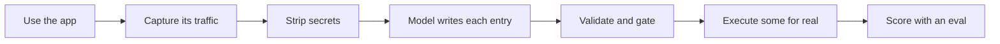

<div align="center">

# brevo-agent-catalog

**What can this app do? Ask the app, not its docs.**


</div>

## What this is

Brevo is an email marketing app. It publishes an API with 292 operations.

**None of those 292 appear in the 197 endpoints the app actually calls.** The
public API and the product are different systems.

So this repo does the obvious thing: it watches the real app, captures what it
calls, and turns that into a catalog an AI agent can use.

## The numbers

| | |
|:--|:--|
| Actions catalogued | **197** in 62 modules |
| Write endpoints found / covered | **38 / 38** |
| Can a model pick the right action? | **17 of 19** tasks |
| Actually executed and proven | **3** (194 are captured but unproven) |
| Public API overlap | **0 of 197** |
| Tests | **470** |

## How it works



The model only writes the parts you cannot get from evidence — the description
and the warnings. Endpoints, methods and proof come from the capture itself.
Asking a model for facts you already have is how documentation gets invented.

## What is in the box

| Path | What |
|:--|:--|
| [`actions/index.json`](actions/index.json) | **Start here.** All 197 actions, one small file |
| `actions/<id>.json` | One action in full: inputs, outputs, risks, proof |
| [`schema/action.schema.json`](schema/action.schema.json) | The contract. A test fails if the code drifts from it |
| `captures/clean/` | The traffic every entry came from |

Ids look like `contacts.create_contact` and `campaigns.send_now`.

## How much to trust it

| Status | Means | Count |
|:--|:--|:--|
| `verified` | We ran it. The request matched what the entry claims | **3** |
| `observed` | Seen in real traffic, never executed | **194** |
| `inferred` | No traffic. Guessed from the UI | **0** |

The three proven ones are one full lifecycle, not three unrelated wins:

```
contacts.create_contact   POST   /contact/backend/contacts/add-contact  -> 200  {"contact_id":8}
contacts.delete_contact   DELETE /contact/backend/contacts/8            -> 200
lists.create_list         POST   /lists/create                          -> 201  {"id":11}
```

Same contact id on both sides of create and delete.

**Read this before trusting a flag.** `destructive` means *irreversible, or
someone outside your account sees it.* Not "not a read".

- Creating a contact is **not** destructive. You can undo it.
- Sending a campaign **is** destructive. It mails real people. No undo.

We tried deriving this from the HTTP method. It failed, because **Brevo reads
using POST.** That shipped `get_count` as destructive — and an agent that learns
to ignore the flag on reads will ignore it on deletes.

## Where the model got it wrong

Every one of these was caught by a check, not by reading the output.

| What | How we found it |
|:--|:--|
| Invented 6 actions out of URLs I had made up myself | Noticed while reading for something else |
| Cited 41 action ids that do not exist | A checker written to look for exactly that |
| Flagged safe reads as destructive, and a risky action as safe | Measuring the rule against all 197 |
| Leaked phone numbers and encoded emails past the gate | Grepping the committed files by hand |
| Hid a rate-limit error behind "the provider failed" | Printing the error we were throwing away |

Two models, split by job: **Groq** for volume, **headless Claude Code** for
judgment. Both behind one interface, so the Groq key is optional.

## Run it

Node 20+ and pnpm. `pnpm install`, then:

```bash
pnpm test          # 470 tests
pnpm validate      # schema + no broken references
pnpm eval          # can a model pick the right action?
pnpm scan          # leak gate, run before any push
```

`captures/clean/` is committed, so everything after capture runs offline for
anyone. Capturing needs your own Brevo account. Full command list:
[docs/approach.md](docs/approach.md).

No credentials in this repo. No Brevo API key exists — proof comes from driving
the real UI. Session files, raw captures and browser traces are gitignored,
checked against the git history before the first push.

## Read more

| Doc | For |
|:--|:--|
| [decisions.md](docs/decisions.md) | 13 decisions, what we rejected, what it cost |
| [gaps.md](docs/gaps.md) | What is broken and what more time buys |
| [eval.md](docs/eval.md) | Every eval run, including the failures |
| [ai-usage.md](docs/ai-usage.md) | How the models were used and what they got wrong |
| [modules.md](docs/modules.md) | Generated inventory of everything |
| [approach.md](docs/approach.md) | How the problem was framed, and the full command list |
