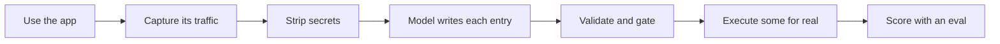

<div align="center">

# brevo-agent-catalog

**What can this app do? Ask the app, not its docs.**


</div>

## What this is

Brevo is an email marketing app. It publishes an API with 292 operations.

**Only 2 of those 292 appear in the 197 endpoints the app actually calls.** The
public API and the product are different systems.

So this repo does the obvious thing: it watches the real app, captures what it
calls, and turns that into a catalog an AI agent can use.

## The numbers

| | |
|:--|:--|
| Actions catalogued | **197** in 62 modules |
| Of those, product features / app plumbing | **170 / 27** |
| Multi-step flows, derived from the capture | **3** (16 steps) |
| Write endpoints found / covered | **38 / 38** |
| Can a model pick the right action? | **15 of 19** tasks (best run 17; see below) |
| Actually executed and proven | **3** (194 are captured but unproven) |
| Public API overlap | **2 of 197** |
| Tests | **517** |

## How it works



The model only writes the parts you cannot get from evidence — the description
and the warnings. Endpoints, methods and proof come from the capture itself.
Asking a model for facts you already have is how documentation gets invented.

## What is in the box

| Path | What |
|:--|:--|
| [`actions/index.json`](actions/index.json) | **Start here.** All 197 actions, one small file |
| [`flows/index.json`](flows/index.json) | The multi-step ones, in order: send a campaign, add a contact, erase a contact |
| `actions/<id>.json` | One action in full: inputs, outputs, risks, proof |
| [`schema/action.schema.json`](schema/action.schema.json) | The contract. A test fails if the code drifts from it |
| `captures/clean/` | The traffic every entry came from |

Ids look like `contacts.create_contact` and `campaigns.send_now`.

## 62 modules were the wrong boxes

A `module` is the first segment of an internal URL. It describes which Brevo
service answers the call, which is the wrong question: 62 modules hold 197
actions, **34 of them hold exactly one**, and sending a single campaign crosses
`email_campaigns`, `editor` and `marketing_campaign`. Nobody asks for a feature
by hostname.

So every action also carries an `area` — one of nine boxes named after what a
person does in the app:

| Area | Actions | What you do there |
|:--|--:|:--|
| `contacts` | 64 | Hold the people you market to; cut them into lists and segments |
| `campaigns` | 38 | Compose and send email, SMS and WhatsApp, and read how they did |
| `platform` | 27 | **Not a feature.** Fonts, locales, feature flags, widget lists |
| `crm` | 21 | Companies, deals, pipelines, tasks, meetings |
| `account` | 21 | Plan, senders, security, integrations, users |
| `transactional` | 10 | The one-to-one mail an app triggers: receipts, resets, SMTP |
| `ecommerce` | 7 | Connect a store, follow orders, run loyalty programmes |
| `automation` | 6 | Workflows that act without anyone pressing send |
| `reporting` | 3 | The cross-product summaries the dashboard shows |

Both groupings ship, because they answer different questions: `module` is for
reading the capture, `area` is for finding a feature.

`platform` exists so the other eight stay honest. Those 27 entries are the web
app drawing itself — `locales.fetch_english`, `editor.list_fonts`,
`navigation.get_header_menu` — and boxing them under a label that says *not a
feature* beats scattering them through the areas a user actually visits.

The assignment is a table in [`src/catalog/areas.ts`](src/catalog/areas.ts), not
a model call: it is a naming decision, and those belong where they can be argued
with. **A module with no area fails the build.** It does not default into
`platform`, because a catch-all that fills itself stops describing anything.

## Reading it as an agent would: `pnpm catalog`

Decision #4 demoted an MCP server. This is the cheaper half of what one would
have provided — an agent already has a shell, so a server adds a protocol and a
lifecycle to a problem that needed neither. It reads the catalog; it never calls
Brevo.

```bash
pnpm catalog                                  # the 9 areas          ~100 tokens
pnpm catalog area contacts                    # 64 names, no prose   ~790 tokens
pnpm catalog show contacts.delete_contact     # one entry in full    ~400 tokens
pnpm catalog search "someone asked to be deleted"
pnpm catalog flow erase_contact               # the recipe, in order
```

Every subcommand takes `--json`. Group listings are names only on purpose:
`contacts` holds 64 entries whose descriptions are 5 773 tokens and whose names
are 787, and the descriptions are paid for on the one entry that gets chosen.
Browsing all three hops costs roughly a twentieth of the 18 519 tokens the whole
index takes.

**The search is the weak part, and it is measured rather than claimed.**
`pnpm bench:search` runs the eval's own 19 tasks through it with no model
anywhere:

| | |
|:--|:--|
| Right answer ranked first | **2 of 19** |
| Right answer in the top 3 | **5 of 19** |
| Right answer anywhere in 10 | **8 of 19** |
| A model reading all 197 entries | **15 of 19** |

That gap is the eval's first rule biting back: a task never reuses the catalog's
wording, so *"I need a new audience group"* has to reach `lists.create_list`
without sharing a word with it. A model bridges that. Prefix matching cannot.

So the honest shape of this tool is **browse, not search**: areas, then an area
listing, then the model picks from names it can see. Trusting the top three
search hits would make an agent worse than handing it everything, and the
command says so in its own output.

Not building a real retrieval layer is a decision, not an omission: the whole
index is 18 519 tokens against the ~200 000 under which published guidance says
to skip retrieval entirely. [gaps.md](docs/gaps.md#why-there-is-no-retrieval-layer-and-what-one-would-look-like)
has the token maths, the sources, and the hybrid-plus-rerank design to reach for
if the catalog ever grows an order of magnitude.

## 197 actions do not say what order to call them in

A flat catalog answers *what can this app do* and is silent on *and then what*.
That silence is measurable: the eval's remaining misses are tasks that take more
than one call, and on both the model picked the listing action that would have
been step one.

So three flows are derived — not written — from the capture:

```
send_email_campaign   8 steps   create > count > recipients > subject > design > preview > test > send
onboard_contact       6 steps   list > company > contact > link > membership > attributes
erase_contact         2 steps   unsubscribe > delete
```

Each flow names a capture file and a time window, and its steps are the write
calls Brevo's own UI made in that window, in that order. `pnpm validate`
re-derives them and fails on any difference, so a flow is a claim about evidence
rather than a claim about memory. Editing `flows/index.json` by hand breaks the
build and prints both sequences.

`erase_contact` is the pair worth reading: step one is reversible and answers
*"stop emailing me"*, step two is irreversible and answers *"delete me"*.
Confusing them is the most expensive mistake an agent can make here.

## How much to trust it

| Status | Means | Count |
|:--|:--|:--|
| `verified` | We ran it. The request matched what the entry claims | **3** |
| `observed` | Seen in real traffic, never executed | **194** |
| `inferred` | No traffic. Guessed from the UI | **0** |

The three proven ones are one full lifecycle, not three unrelated wins:

```
contacts.create_contact   POST   /contact/backend/contacts/add-contact  -> 200  {"contact_id":8}
contacts.delete_contact   DELETE /contact/backend/contacts/8            -> 200
lists.create_list         POST   /lists/create                          -> 201  {"id":11}
```

Same contact id on both sides of create and delete.

**Read this before trusting a flag.** `destructive` means *irreversible, or
someone outside your account sees it.* Not "not a read".

- Creating a contact is **not** destructive. You can undo it.
- Sending a campaign **is** destructive. It mails real people. No undo.

We tried deriving this from the HTTP method. It failed, because **Brevo reads
using POST.** That shipped `get_count` as destructive — and an agent that learns
to ignore the flag on reads will ignore it on deletes.

## Where the model got it wrong

Every one of these was caught by a check, not by reading the output.

| What | How we found it |
|:--|:--|
| Invented 6 actions out of URLs I had made up myself | Noticed while reading for something else |
| Cited 41 action ids that do not exist | A checker written to look for exactly that |
| Flagged safe reads as destructive, and a risky action as safe | Measuring the rule against all 197 |
| Leaked phone numbers and encoded emails past the gate | Grepping the committed files by hand |
| Hid a rate-limit error behind "the provider failed" | Printing the error we were throwing away |

Two models, split by job: **Groq** for volume, **headless Claude Code** for
judgment. Both behind one interface, so the Groq key is optional.

## Run it

Node 20+ and pnpm. `pnpm install`, then:

```bash
pnpm test          # 517 tests
pnpm validate      # schema + no broken references + flows match their captures
pnpm build:flows   # re-derive flows/index.json from the captures
pnpm eval          # can a model pick the right action? (costs provider quota)
pnpm bench:search  # can the CLI search find it with no model at all? (free)
pnpm scan          # leak gate, run before any push
```

`captures/clean/` is committed, so everything after capture runs offline for
anyone. Capturing needs your own Brevo account. Full command list:
[docs/approach.md](docs/approach.md).

No credentials in this repo. No Brevo API key exists — proof comes from driving
the real UI. Session files, raw captures and browser traces are gitignored,
checked against the git history before the first push.

## Read more

| Doc | For |
|:--|:--|
| [decisions.md](docs/decisions.md) | 16 decisions, what we rejected, what it cost |
| [gaps.md](docs/gaps.md) | What is broken and what more time buys |
| [eval.md](docs/eval.md) | Every eval run, including the failures |
| [ai-usage.md](docs/ai-usage.md) | How the models were used and what they got wrong |
| [modules.md](docs/modules.md) | Generated inventory of everything |
| [approach.md](docs/approach.md) | How the problem was framed, and the full command list |
