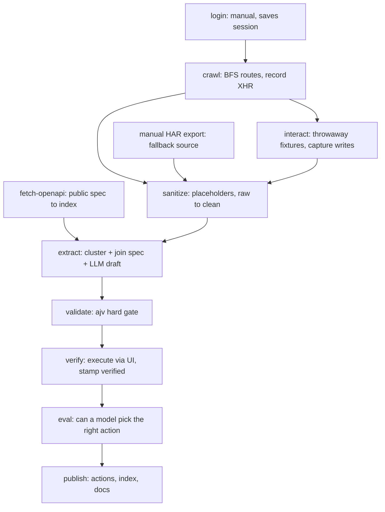

# brevo-agent-catalog

A catalog of Brevo's **business actions** — everything a user can do by clicking
around the product — in a form an AI agent can act on without a human checking
its work first.

> **Status: pipeline complete and tested; not yet run against a live account.**
> Every stage is implemented and covered by tests (241 passing). The stages that
> require an authenticated Brevo session — the crawl, the write passes and
> verification — need a manual login and have not run, so `actions/` is empty.
> See [Running it](#running-it). Nothing in this repository reports a result it
> has not measured.

## Why this exists

Many systems have no public API, or one that does not cover what the product
actually does. An agent operating software like that needs to know what the
software can do before it can do anything.

Brevo turns out to be a clean example, and the gap is measurable. Brevo publishes
an OpenAPI 3.0.1 specification (`data/brevo-openapi.yml`, committed) with
**292 operations across 208 paths**. But the public API and the product only
*overlap*:

- **79 of those 292 operations** are master-account, balance, program, reward,
  tier and wallet surface — partner and reseller APIs that no ordinary user ever
  meets in the UI.
- There is **no tagged coverage at all** for automation and workflows, landing
  pages, forms, meetings or push notifications — all of which exist in the
  product.

So reading the API docs is not a substitute for clicking around the app. That is
the whole argument for this project, and it is why the pipeline starts in a
browser rather than in a specification.

## How to read the catalog

| Path | What it is |
|---|---|
| `actions/index.json` | Load this first. Every action's id, module, name, description, confidence and destructive flag. One small file. |
| `actions/<id>.json` | One action in full: typed inputs, outputs, preconditions, side effects, UI path, internal endpoint, public-API mapping, verification. |
| `schema/action.schema.json` | The contract, JSON Schema draft 2020-12. Generated from `src/types.ts`; a test fails if the two drift. |

Ids are `module.verb_object` in snake_case — `contacts.create_contact`,
`campaigns.send_campaign`.

### What the confidence levels mean

This is the part to read before trusting anything. The catalog does not pretend
to uniform confidence.

| Status | Earned when | Evidence |
|---|---|---|
| `verified` | The harness executed the action end to end against a real account, and the observed request and response match what the entry claims | The sanitized real request/response, plus `verified_at` |
| `observed` | The action's internal endpoint was captured in **real traffic** — method, path and body shape are factual — but it was never executed, or only partly | A path into `captures/clean/` |
| `inferred` | No captured traffic. Derived from UI affordances, the public OpenAPI spec, or model judgment | What it was derived from, named |

Two rules that are enforced in code, not just stated here:

- **Spec-derived does not beat `inferred`.** An entry whose inputs come from
  Brevo's published spec is still unexecuted. `public_api.exists` tells you the
  inputs come from a published contract; it does not promote the status.
- **Partial execution does not earn `verified`.** A request that ran and returned
  4xx is `observed`, with the reason recorded.

### The `destructive` and `idempotent` flags are fail-safe

A harness uses `destructive` to decide whether to stop and ask a human, so a
wrong value there is the most expensive error this catalog could carry. Until
execution proves otherwise, **every non-read action is `destructive: true` and
`idempotent: false`**. That is applied in code after schema validation, not
merely requested of the model. Only a `verified` outcome can relax either flag.

If an entry is `inferred` and says `destructive: true`, that may mean "we know
this deletes things" or "we have not proven it doesn't". Check
`verification.status` before reading anything into the flags.

## How it was built

The design principle is to spend the model only on what cannot be derived. Where
a captured endpoint maps onto a public operation, the required fields, enums and
limits are inherited from Brevo's own specification deterministically — no
guessing, and `public_api` fills itself. The model is asked only for semantics:
the agent-facing description, preconditions, side effects, and the risk
judgments. Mechanical fields (`internal_endpoint`, `public_api`,
`verification`) are filled from evidence in code, because asking a model for
facts you already hold is the main source of fabricated documentation.

Two models, for a reason: **Groq** runs the high-volume breadth pass across every
discovered route, and **headless Claude Code** handles the core tier and the
judgment-heavy fields. Both sit behind one interface (`src/providers/types.ts`),
so the Groq key is optional and a reviewer can substitute their own provider.

## Running it

Requires Node 20+ and pnpm. `pnpm install`, then:

| Command | Stage | Needs |
|---|---|---|
| `pnpm fetch:openapi` | Download and index Brevo's public spec | nothing |
| `pnpm login` | Save an authenticated session to `.auth/` | **a manual login by hand** |
| `pnpm crawl` | BFS the app, record XHR to `captures/raw/` | a saved session |
| `pnpm interact` | Write passes with throwaway fixtures | a saved session |
| `pnpm sanitize` | `captures/raw` → `captures/clean`, redacted | captures |
| `pnpm extract` | Draft catalog entries | clean captures + a provider |
| `pnpm validate` | ajv gate over `actions/` | drafted actions |
| `pnpm build:index` | Write `actions/index.json` | valid actions |
| `pnpm verify` | Execute chosen actions, stamp `verified` | a saved session + a catalog |
| `pnpm eval` | Score whether a model picks the right action | a catalog index |
| `pnpm build:docs` | Regenerate `docs/modules.md` | a catalog index |
| `pnpm scan` | **Leak gate.** Run before any push | nothing |
| `pnpm test` / `pnpm typecheck` | 241 tests, strict TypeScript | nothing |

**Credentials.** Nothing in this repository contains any, and none is committed.
`pnpm extract` with `--provider groq` wants `GROQ_API_KEY` in `.env` (see
`.env.example`); with `--provider claude` it shells out to an already
authenticated `claude` CLI and needs no key at all. There is **no Brevo API key**
anywhere — verification drives the real UI instead, which is the only way to
reach the UI-only surfaces where this catalog is worth the most.

**Reproducibility, honestly.** Stages 0 and 4–8 run offline for anyone from the
committed spec and clean captures. The crawl stages need a Brevo account of your
own, and are documented rather than runnable — which the brief explicitly allows.

## Safety

This repository is public, so the pipeline treats that as a hard constraint.

- `.env`, `.auth/` and `captures/raw/` are gitignored from the first commit.
- Sanitization is **by shape, wherever it occurs** — a key in a query string, a
  token nested deep in a body, a cookie header. Not just known field names.
- Identifiers become structure-preserving placeholders (`{{ACCOUNT_ID}}`,
  `{{LIST_ID}}`, `{{EMAIL}}`), never bare removal, so `body_example` stays usable
  by an agent.
- `pnpm scan` is an **independent** second opinion — it re-derives the patterns
  rather than asking the redactor what it would have replaced, because a gate
  implemented by calling the thing it checks cannot fail.
- The crawl is capped at 1 request/second, clicks nothing, and never follows a
  log-out link. Writes happen only in the explicit `interact` and `verify`
  stages, only ever creating `catalog-test-`-prefixed fixtures, and nothing in
  this repository deletes account data.

## Documents

| Document | What it covers |
|---|---|
| [docs/approach.md](docs/approach.md) | How the problem was framed and what was prioritized |
| [docs/decisions.md](docs/decisions.md) | Every architectural decision, its rejected alternatives, and the cost accepted |
| [docs/ai-usage.md](docs/ai-usage.md) | Tools, models, workflow, and what had to be fixed by hand |
| [docs/gaps.md](docs/gaps.md) | Known gaps and limitations, and what more time would buy |
| [docs/eval.md](docs/eval.md) | Selection-eval results and what the failures taught |
| [docs/modules.md](docs/modules.md) | Generated inventory of modules, actions and uncovered routes |
| [docs/superpowers/specs/](docs/superpowers/specs/) | The design document, written before any code |
| [docs/superpowers/plans/](docs/superpowers/plans/) | The implementation plan it produced |
