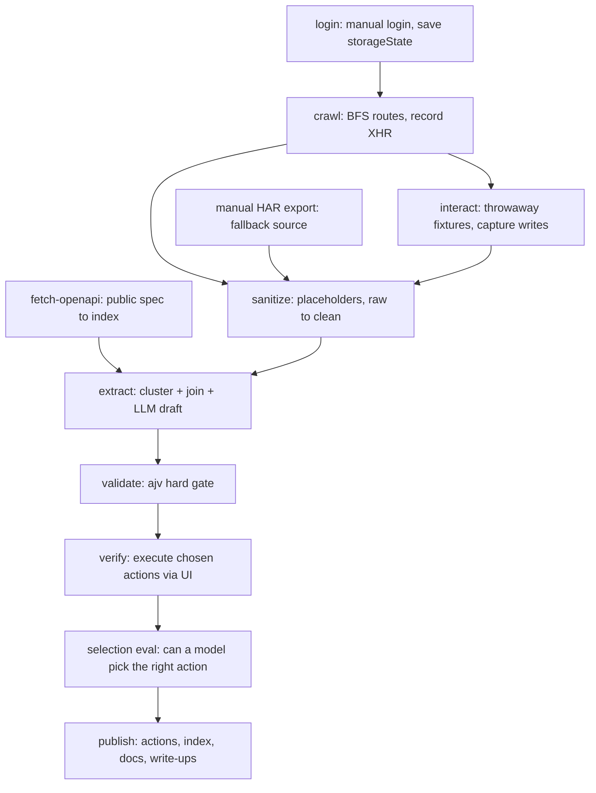

# brevo-agent-catalog — Design

Date: 2026-11-06
Author: Weine Oliveira
Status: approved design, pending implementation plan

---

## 1. Intent and why

This repository is a submission for a take-home challenge from Monarch (TestBox),
for a Senior AI Systems Engineer role. It is reviewed by Eduardo Godoy, who leads
Engineering at Monarch and would be the hiring manager.

The challenge: **reverse engineer Brevo (brevo.com) and build a catalog of
business actions — everything a user can do by clicking around the product —
designed to be consumed by AI agents rather than read by people.**

The underlying real-world problem, stated in the brief: many systems have no
public API, or a public API that does not cover what the product actually does.
For an AI agent to operate such software, it must first know what the software
can do. The catalog is that knowledge, in machine-readable form.

Reconnaissance already confirms the premise concretely for Brevo. Brevo publishes
an OpenAPI 3.0.1 specification at `https://api.brevo.com/v3/swagger_definition_v3.yml`
(1.2 MB, public, unauthenticated) containing **208 paths / 292 operations, 208 of
which carry an `operationId`**. But the public API and the product only *overlap*:

- Roughly **79 of 292 operations** are master-account, balance, program, reward,
  tier and wallet surface — partner and reseller APIs that a normal user never
  encounters in the UI.
- There is **no tagged coverage for automation/workflows, landing pages, forms,
  meetings or push notifications**, all of which exist in the product.

That measured gap is the argument for the whole exercise and belongs in the
write-up: reading the API docs is not a substitute for clicking around the app.

### How the submission is evaluated

| Axis | What it means here |
|---|---|
| **Coverage** | How much of what a user can do in Brevo was found |
| **Reliability** | Could an agent trust an entry and act on it with no human double-check |
| **Use of AI** | The *system* designed to get there, not only the output |

Weighting given in the brief: 20% approach and plan, 70% implementation,
10% delivery. After review, a 30-minute call where Eduardo walks through the
catalog and probes edge cases — so every entry must survive being questioned.

---

## 2. Goals

- **G1 — Breadth.** A broad inventory of Brevo business actions, discovered by
  crawling the real authenticated application, not by reading documentation.
- **G2 — Depth on core.** A *core tier* of actions specified in full and
  genuinely verified by executing them against a real free-tier account.
- **G3 — Honest, machine-readable confidence.** Every entry states whether it is
  `verified`, `observed` or `inferred`, with evidence, under the rules in §7.2.
  An agent can filter to what it is allowed to trust.
- **G4 — Agent-consumable, and proven so.** JSON files plus an index are the
  deliverable. A **selection eval** measures whether a model can actually resolve
  a natural-language task to the right action with the right inputs — the
  catalog's agent-readability is reported as a number, not asserted.
- **G5 — The written deliverables.** Approach and priorities, how AI was used
  (tools, models, workflow, what had to be fixed by hand), and known gaps with
  what would come next. Plus a standing **decision record** (`docs/decisions.md`)
  carrying every architectural choice with its rejected alternatives and the cost
  accepted — the 30-minute call is edge-case probing, and these answers should be
  written down before it, not improvised in it.
- **G6 — Safe to publish.** The repository goes public on GitHub. No
  credentials, no session state, no raw captures, no personal data.

## 3. Non-goals

- **Not exhaustive.** Completeness across all of Brevo is not attainable by
  Monday and is not claimed. The uncovered surface is named explicitly.
- **Not human documentation.** No docs site, no prose tutorials. `docs/` exists
  to orient the reviewer, not to teach Brevo.
- **Not an execution engine.** The catalog *describes* actions; nothing in the
  repository performs Brevo actions at runtime. Execution is named in the
  write-up as the next step.
- **Not an MCP server** as a planned deliverable — demoted to a stretch goal
  (D4). The catalog is consumable as files; a server would add nothing to
  Coverage, Reliability or Use of AI, and would cost weekend hours that those
  axes need.
- **Not the partner/reseller API surface.** Master account, balance, program,
  reward, tier and wallet operations are excluded as out-of-product.
- **Not paid-plan features.** What a free-tier account cannot reach is recorded
  in `plan_tier` rather than guessed at.

## 4. Anti-goals — what makes this a failure even if it runs

- **Uniform false confidence.** Entries that read as authoritative but are
  guesses. An agent acting on a fabricated precondition or a wrong `destructive`
  flag is worse than an agent with no catalog at all. This is the single
  most important failure mode; `verification` and §7.2 exist to prevent it.
- **A catalog only a human can use.** If an entry needs a person to interpret it
  before an agent can act, it has missed the brief. The selection eval is the
  check against this.
- **A leak.** Any credential, session cookie, API key, or the author's real
  email or account identifiers reaching the public repository.
- **An impressive crawler with no semantics.** Hundreds of captured HTTP calls
  are not a catalog. The value is in the extracted meaning.
- **Polish in front of thinness.** Infrastructure that looks sophisticated
  (transport layers, servers) while the catalog itself is shallow. Every hour
  goes to coverage, accuracy, or the write-ups first.

---

## 5. Constraints

- **Deadline: Monday 2026-11-09.** (The brief states 24 hours; the operative
  deadline is Monday, set by the author. Design to the weekend.)
- **Account:** the author's own Brevo **free-tier** account.
- **Mutation is sanctioned, with bounds** (author's decision, D11). The scripts
  **may** create throwaway data — test contacts, test lists, saved drafts — in
  order to capture real write-request bodies, and **may** send test emails. They
  **may delete only fixtures the harness itself created**, and must never touch
  pre-existing data in the account.
- **Stack, decided:** TypeScript on Node 20, pnpm, Playwright, Zod, ajv.
- **Language:** the entire repository is in **English**, without exception.
- **Delivery:** public GitHub repository under the author's account; submission
  is one email to the recruiter and the hiring manager (address redacted for publication).
- **Crawl politeness:** same domain only, BFS, maximum 1 request per second. The
  automated link crawl does not click send/delete controls; all mutation happens
  in the separate, explicit interaction and verification stages.
- **Never committed:** `.env`, `.auth/`, `captures/raw/`, `node_modules`.
  `.gitignore` carries these from the first commit.
- **Credentials:** a Groq API key, supplied via `.env` only. (The key first
  pasted in chat is considered compromised and is being rotated.) The Claude
  half of the pipeline uses the machine's existing authenticated `claude` CLI;
  no Anthropic API key exists or is required. No Brevo API key is needed — see
  D12.
- **Rate limits:** Groq free tier imposes request/token limits the breadth pass
  must pace around.
- **Repository location:** `C:\Users\Weine Oliveira\Projetos\brevo-agent-catalog`.

---

## 6. Decisions already made

Marked **[W]** where the author decided, **[B]** where the builder decided and
the author can overrule.

| # | Decision | By |
|---|---|---|
| D1 | Two tiers: a core tier specified and verified in depth, a breadth tier catalogued honestly at lower confidence | **[W]** |
| D2 | What counts as "core" is decided **after** the crawl, from what is actually there. Core = the functionalities that make up the main platform experience (send an email, create a campaign, add a contact, manage lists). Account housekeeping such as changing a username is not core | **[W]** |
| D3 | **What is worth verifying, and how much, is decided together after the catalogue exists** — not committed up front. The verify harness is therefore built generic rather than per-action | **[W]** |
| D4 | The deliverable is JSON files plus an index. A **selection eval** replaces the MCP server as the proof of agent-consumability; the MCP server is a Sunday stretch goal, built only if core work and write-ups are done | **[W]** |
| D5 | Two-model pipeline: **Groq** for the high-volume breadth pass, **headless Claude Code** (`claude -p`) for the core tier and judgment-heavy fields. Both behind one provider interface with two adapters, so the Groq key is optional and a reviewer can substitute their own provider | **[W]** |
| D6 | The public OpenAPI spec is used as *deterministic enrichment*: where an internal endpoint maps to a public operation, typed inputs, enums, required fields and limits are inherited from the spec rather than inferred, and `public_api` fills itself | **[B]** |
| D7 | `description` is written as **trigger conditions plus disambiguation against neighbouring actions** ("Call this when…; use X instead if…"), not as a restatement of what the endpoint does. This is the single largest lever on an agent picking the right action | **[B]** |
| D8 | ajv validation against the schema is a **hard gate**: a draft entry that does not validate never lands in `actions/` | **[W]** + **[B]** |
| D9 | `captures/clean/` **is** committed (only `captures/raw/` is ignored), because `verification.evidence` points into it. It passes a secret-scan gate before any commit | **[B]** |
| D10 | Repository is public on GitHub under the author's account | **[W]** |
| D11 | Mutation bounds as stated in §5: create and send yes; delete only own fixtures; never touch pre-existing data | **[W]** |
| D12 | Verification executes actions **through the UI with Playwright**, not by replaying internal endpoints and not through the public API. Rationale: it proves the *business action as a user performs it*, it is the only mechanism that reaches the UI-only surfaces (automation, landing pages, forms) where the catalog's value is highest, and it needs no Brevo API key. Replay was rejected as brittle against CSRF/session expiry; public-API calls were rejected because they only reach the subset that least needs proving, which would make `verified` a near-worthless signal | **[B]** |
| D13 | Verification fixtures are created by the harness, namespaced (e.g. `catalog-test-*`), and deleted by the harness afterwards. Evidence for a `verified` entry = the sanitized capture of the real request/response plus the Playwright trace path | **[B]** |
| D14 | Reproducibility target: **auditable, not fully runnable by a third party.** Stages 0 and 4–7 run offline for anyone, from committed clean-capture fixtures. Stages 1–3 need the author's own Brevo account and are documented rather than runnable, which the brief explicitly permits ("If something needs a key to run, describe it instead") | **[B]** |
| D15 | Sanitization replaces identifiers with **structure-preserving placeholders** (`{{ACCOUNT_ID}}`, `{{LIST_ID}}`, `{{CAMPAIGN_ID}}`, `{{EMAIL}}`), never bare removal, so `internal_endpoint.body_example` stays usable by an agent. The secret-scan gate asserts the absence of key/token shapes **and** of the author's real account identifiers and email addresses | **[B]** |
| D16 | Captures enter the pipeline through a **capture-source abstraction**. The Playwright crawl is one source; a hand-exported DevTools HAR is another. If login or crawling is blocked (2FA, captcha, bot detection), stages 3–7 still run from a manual HAR, so stage 2 is not a single point of failure | **[B]** |
| D17 | When `destructive` / `idempotent` cannot be proven, they are **fail-safe**: any non-read action is `destructive: true, idempotent: false` until verification says otherwise. The flags stay plain booleans because a harness needs a definite gate signal; their provenance is carried by `verification.status`, and the README states this rule explicitly | **[B]** |

---

## 7. The system

### 7.1 Schema — `schema/action.schema.json`

JSON Schema draft 2020-12. One entry per business action.

| Field | Meaning |
|---|---|
| `id` | snake_case, `module.verb_object` (e.g. `contacts.create_contact`) |
| `module` | owning module |
| `name` | short human label |
| `description` | **written for an agent**: when to call this, and which neighbouring action to use instead |
| `preconditions[]` | what must hold before the call can succeed |
| `inputs` | JSON Schema: types, `required`, `enum`s, limits, per-property descriptions |
| `outputs` | what comes back |
| `side_effects[]` | observable consequences |
| `destructive` | boolean — the harness's signal to gate behind confirmation (D17) |
| `idempotent` | boolean — whether a retry is safe (D17) |
| `ui_path[]` | navigation steps a UI-driving agent would follow |
| `internal_endpoint` | `{method, path, body_example}`, sanitized per D15 |
| `public_api` | `{exists, operationId}` |
| `plan_tier` | which plan reaches this action |
| `verification` | `{status, evidence, verified_at}` — see §7.2 |

Zod mirrors the schema for typed use inside the scripts; ajv validates the
emitted artifacts. The two must not drift — see §8.

Note the correspondence worth stating in the write-up: these fields map almost
one-to-one onto what makes a *tool definition* good (specific names,
trigger-condition descriptions, per-property schemas with enums, reversibility
signals, informative preconditions). The catalog is not documentation that
happens to be JSON — it is a **tool-definition source**, one deterministic
transform away from a live agent tool surface.

### 7.2 What the confidence levels mean

This table is normative, goes into the README verbatim, and is what the
extraction prompts are held to. It is the submission's honesty mechanism and the
most likely thing to be probed on the call.

| Status | Earned when | Evidence |
|---|---|---|
| `verified` | The harness executed the action end to end against the real account, and the observed request and response match what the entry claims | Sanitized capture of the real request/response, plus the Playwright trace path, plus `verified_at` |
| `observed` | The action's internal endpoint was captured in **real traffic** — so method, path and body shape are factual — but the harness never executed it, or executed only part of it | Path into `captures/clean/` |
| `inferred` | No captured traffic for this action. The entry is derived from UI affordances, the public OpenAPI spec, or model judgment | What it was derived from, named |

Two rules that follow, and must not be fudged:

- **Spec-derived does not beat `inferred`.** An entry whose inputs come from the
  public OpenAPI spec is still unexecuted. `public_api.exists` already tells a
  reader the inputs come from a published contract; it does not promote the
  status.
- **Partial execution does not earn `verified`.** It earns `observed`.

### 7.3 Pipeline

| Stage | Script | Output |
|---|---|---|
| 0 | `scripts/fetch-openapi.ts` | `data/public-api-index.json` — method+path → `operationId`, params, enums, required fields |
| 1 | `scripts/login.ts` | Headed Chromium; author logs in manually at `app.brevo.com`; saves `.auth/state.json` |
| 2 | `scripts/crawl.ts` | Uses the storage state. Reads sidebar and tab links, BFS over same-domain routes, ≤1 req/s. Records every XHR/fetch (method, URL, status, truncated request and response bodies) to `captures/raw/`. Does not click send/delete |
| 2b | `scripts/interact.ts` | Per-module interaction passes that create throwaway fixtures and save drafts, so write-action request bodies, enums and validation errors are captured rather than guessed (D11) |
| 3 | `scripts/sanitize.ts` | `captures/raw/` → `captures/clean/`: strips `cookie`, `authorization`, `x-csrf*`; replaces identifiers with placeholders (D15). Accepts any capture source (D16) |
| 4 | `scripts/extract.ts` | Clusters clean captures by route and endpoint, joins each against the OpenAPI index, and runs the LLM pass (Groq for breadth, `claude -p` for core) to draft entries against the schema |
| 5 | `scripts/validate.ts` | ajv over every draft; failures are rejected and reported, never silently dropped |
| 6 | `scripts/verify.ts` | Executes the chosen actions through the UI (D12), stamps `verification` per §7.2, cleans up its fixtures (D13) |
| 7 | `scripts/eval-selection.ts` | Natural-language tasks → does a model pick the right action and fill the inputs? Reports a score and the failures |
| 8 | — | `actions/*.json`, `actions/index.json`, `docs/`, `README.md` |

**Why this split.** Stage 0 and the join in stage 4 are deterministic: where the
public API overlaps the app, nothing is guessed. The LLM is spent only on what
cannot be derived — UI-only actions, preconditions, agent-facing descriptions,
and the destructive/idempotent judgments. Stage 6 is what makes `verified` mean
something. Stage 7 is what makes "agent-consumable" a measurement rather than a
claim — and its failures are feedback into the descriptions, which is the most
valuable loop in the system.

**The number that belongs in the write-up.** Verification is not only a stamp;
it measures the pipeline's error rate. "Of N drafted entries executed, M had
incorrect required fields or invented preconditions; here is what I changed in
the prompts" is a far stronger claim than a count of verified actions, and it is
precisely the "what you had to fix and verify yourself" the brief asks for.

### 7.4 Deliverables

| Artifact | Purpose |
|---|---|
| `README.md` | The reviewer's entry point: what this is, how it was solved, where to look next, and the §7.2 table. Written knowing it is read first |
| `actions/*.json` | The catalog — source of truth |
| `actions/index.json` | Flat index (id, module, name, description, status) so a consumer loads one file |
| `schema/action.schema.json` | The contract |
| `docs/modules.md` | Inventory of modules and routes discovered |
| `docs/approach.md` | How the problem was framed, what was prioritized and why. Narrative; links to `decisions.md` rather than repeating it |
| `docs/decisions.md` | **The architecture decision record.** One entry per decision: what was decided, the alternatives rejected, why, and **the cost accepted**. Derived from §6, written for the reviewer rather than for the builder. This is the prepared answer to the edge-case questions in the 30-minute call |
| `docs/superpowers/specs/2026-11-06-brevo-agent-catalog-design.md` | This document, linked from the README as evidence the plan preceded the code |
| `docs/ai-usage.md` | Tools, models, workflow; what AI got wrong and what was fixed by hand |
| `docs/gaps.md` | Known gaps and limitations; what more time would buy |
| `docs/eval.md` | Selection-eval results and what the failures taught |
| `captures/clean/` | Sanitized evidence backing `verification.evidence`, and the offline fixtures for D14 |
| `mcp/` | **Stretch only.** Thin server over the catalog, if time remains |

---

## 8. Left to the builder

- **Repository and file layout** beyond the paths named above; module taxonomy
  and the exact `id` vocabulary.
- **Capture clustering heuristics** in stage 4: how captures are grouped into
  candidate actions, how noise (telemetry, analytics, polling, assets) is
  filtered out.
- **Prompt design** for both passes, and the retry/repair loop when a draft
  fails ajv.
- **Keeping Zod and JSON Schema in step** — generate one from the other, or test
  that they agree. Either is acceptable; drift is not.
- **The interaction passes in stage 2b:** which modules get one, and how far each
  goes before it has seen enough.
- **The selection-eval task list:** how many tasks, how they are written so they
  are not a restatement of the descriptions they are testing, and how "correct"
  is scored.
- **Test strategy.** At minimum: the schema rejects malformed entries, the
  sanitizer provably removes known secret and identifier shapes, the index
  matches the files. Full TDD across the crawler is not expected under the
  deadline.
- **How `plan_tier` is determined** for actions a free-tier account cannot
  reach — upsell screens and gating observed during the crawl are the signal.
- **Crawl breadth tuning:** route budget, depth limits, crawl duration.
- **Secret-scan gate** implementation before the first public push (D9, D15).
